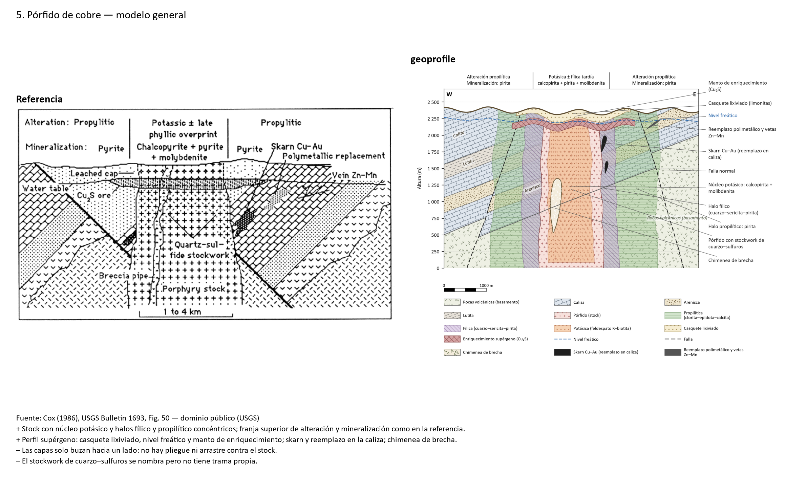
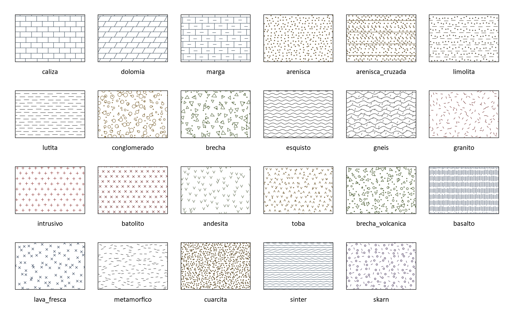

<p align="center"></p>

# geoprofile

Skill de [Claude Code](https://claude.com/claude-code) que dibuja **figuras de geología con aspecto de informe
real**, en PNG listo para una lámina, un informe o una exposición:

- **Secciones geológicas** con capas que buzan, discordancias que truncan a lo de abajo y fallas que desplazan
  bloques y quedan selladas por las capas más jóvenes.
- **Cortes de alteración alrededor de vetas** (epitermales): halos con color y trama, veta con pinch & swell y
  ramales, clavo con brecha, nivel de ebullición e intervalos metálicos.
- **Modelos de yacimiento**: pórfidos con núcleo potásico y halos fílico y propilítico, skarn, hot-spring, lentes de
  mena a lo largo de estructuras, perfil supérgeno con casquete lixiviado, nivel freático y enriquecimiento.
- **Columnas estratigráficas** con perfil de meteorización, barras de era y periodo, tramos cortados y discordancias
  según su tipo.

Los contactos son irregulares, nunca rectas; las litologías llevan las tramas del estándar FGDC del USGS (caliza en
ladrillo, arenisca en puntos, lutita en guiones, esquisto ondulado, granito, pórfido…) girando con el buzamiento; y
cada figura trae cotas o alturas, orientación, escala gráfica, leyenda con las mismas tramas y rótulos con líneas
guía que no se enciman.

Lo que no hace: no lee datos (sondajes, modelos de bloques, topografía digital) ni dibuja a escala exacta, y no hace
mapas en planta. Cada figura es una interpretación descrita en un archivo JSON.



## Instalación

```bash
git clone https://github.com/rars2021/geoprofile
pip install -r geoprofile/requirements.txt
```

Abre Claude Code en la carpeta del repo, o copia o enlaza `.claude/skills/geoprofile` a `~/.claude/skills/` para
tenerla en todas las sesiones. Requiere Python 3.10 o más nuevo con numpy, matplotlib, shapely y Pillow.

## Uso

Pídeselo a Claude: «haz un perfil geológico de…», «corte de alteración de una veta epitermal», «modelo de pórfido de
cobre con perfil supérgeno», «columna estratigráfica de…».

O a mano:

```bash
python .claude/skills/geoprofile/scripts/geoprofile.py perfil  config.json seccion.png
python .claude/skills/geoprofile/scripts/geoprofile.py columna config.json columna.png
python .claude/skills/geoprofile/scripts/geoprofile.py ejemplo carpeta           # ejemplo completo (mina Arcata, Perú)
python .claude/skills/geoprofile/scripts/geoprofile.py tramas  muestrario.png    # las 23 tramas
```

El JSON lleva solo lo que cambia. Con `"plantilla": "vacia"` se parte de una figura en blanco. Los siete configs de
[`pruebas/configs/`](pruebas/configs) son buenos puntos de partida: copia el más parecido a tu caso y cambia capas,
cotas y rótulos. La guía completa (claves, reglas de dibujo y trampas) está en
[`SKILL.md`](.claude/skills/geoprofile/SKILL.md).

## Pruebas contra figuras reales

La skill se probó reproduciendo siete figuras públicas del USGS y del NPS: una sección del Grand Canyon con
discordancias y bloques fallados, una mina de uranio con lentes a lo largo de una falla, la columna del Grand Canyon,
y los modelos de veta tipo Creede, pórfido de cobre, hot-spring de Au-Ag y skarn de cobre. Cada comparación lado a
lado, con lo que sale bien y lo que todavía falla, está en [`pruebas/comparaciones/`](pruebas/comparaciones); las
fuentes, en [`pruebas/FUENTES.md`](pruebas/FUENTES.md), y lo pendiente, en [`pruebas/MEJORAS.md`](pruebas/MEJORAS.md).
Para repetirlas: `python pruebas/generar.py`.

## Licencia

Código y skill: [MIT](LICENSE), de uso libre. Las figuras que genera geoprofile (ejemplos y `pruebas/salidas/`) se
pueden reutilizar bajo CC BY 4.0. Las figuras de referencia son obras del Gobierno de EE. UU. en dominio público
(detalle en `pruebas/FUENTES.md`).
